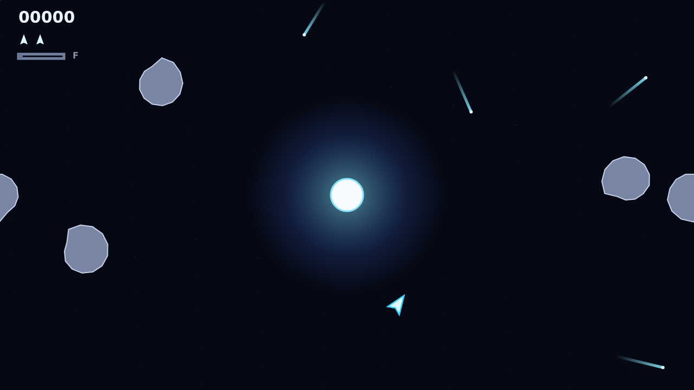

# Shatter

Shatter drops you into a wrapped field of deep space with a bright gravity well
at its center. Your ship is all momentum: turn, thrust, coast, and use the star
as the board's dangerous anchor while rocks bend around it.

The gun is simple, but the well makes every shot interesting. Bullets curve as
they cross the center, so a clean hit can mean banking fire around the star
instead of flying straight at a target.

Large rocks are armored. Chip them until they burst into smaller fragments, watch
the damage build, and keep pushing until the wave is gone. If the core swallows a
rock, it comes back from the edge with its armor still on.

When the field gets too crowded, Warhead gives you one decisive answer: a homing
torpedo that recharges over ten seconds, ignores the well, and shatters any rock
it catches. Save it for the shot that matters.
